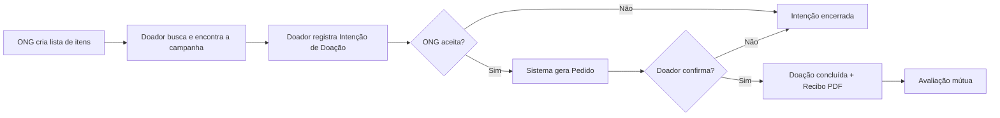
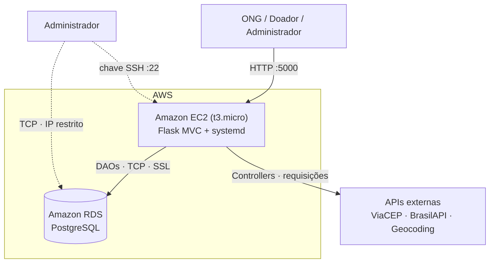

<div align="center">

# 🤝 SolidariHub

**Plataforma web que conecta ONGs e doadores de forma simples, segura e transparente.**


</div>

---

## 📑 Sumário

- [Sobre o projeto](#-sobre-o-projeto)
- [Funcionalidades](#-funcionalidades)
- [Perfis de usuário](#-perfis-de-usuário)
- [Fluxo de doação](#-fluxo-de-doação)
- [Arquitetura](#-arquitetura)
- [Modelo de dados](#-modelo-de-dados)
- [Tecnologias](#-tecnologias)
- [Estrutura do repositório](#-estrutura-do-repositório)
- [Como executar localmente](#-como-executar-localmente)
- [Testes](#-testes)
- [Deploy na AWS](#-deploy-na-aws)
- [Segurança e LGPD](#-segurança-e-lgpd)
- [Decisões de projeto](#-decisões-de-projeto)
- [Trabalhos futuros](#-trabalhos-futuros)
- [Documentação acadêmica](#-documentação-acadêmica)
- [Autores](#-autores)

---

## 💡 Sobre o projeto

O funcionamento das ONGs depende majoritariamente da solidariedade de doadores. Hoje, porém, o processo é **descentralizado**: cada ONG usa canais diferentes para divulgar o que precisa, o doador fica sem saber o que é prioridade e a ONG tem dificuldade de controlar o que já foi doado. Essa falta de comunicação clara pode gerar desistência de contribuições e afastar potenciais benfeitores.

O **SolidariHub** centraliza esse processo: a ONG cadastra suas campanhas com os itens de que precisa, o doador encontra e manifesta interesse em ajudar, e o sistema acompanha tudo até a entrega, com rastreabilidade e transparência.

> Projeto desenvolvido como Trabalho de Conclusão de Curso (2025) na **Universidade de Mogi das Cruzes (UMC)**.

---

## ✨ Funcionalidades

| Funcionalidade | Descrição |
|---|---|
| **Cadastro e validação** | ONGs e doadores se cadastram; o administrador verifica e autentica os dados das ONGs antes de liberarem o acesso completo. |
| **Listas (campanhas)** | ONGs aprovadas criam listas de itens necessários, organizados por categoria, subcategoria e quantidade. |
| **Busca por geolocalização** | Doadores encontram ONGs próximas ou pesquisam por palavra-chave. |
| **Intenção de doação** | O doador demonstra interesse em doar para uma lista específica. |
| **Pedido de doação** | Após a confirmação mútua entre ONG e doador, o sistema gera um pedido formal. |
| **Acompanhamento de status** | Histórico de listas, intenções e pedidos. |
| **Recibo em PDF** | A ONG pode gerar o recibo da doação concluída para controle próprio. |
| **Avaliação mútua (feedback)** | Após a finalização do pedido, doador e ONG se avaliam, fortalecendo a reputação e a confiança na plataforma. |
| **Recuperação de senha** | Envio de e-mail para redefinição de senha. |

---

## 👥 Perfis de usuário

| Perfil | O que pode fazer |
|---|---|
| 🏢 **ONG** | Publicar e gerenciar campanhas, receber intenções de doação, acompanhar pedidos, gerar recibos e avaliar doadores. |
| 🙋 **Doador** | Buscar ONGs e campanhas, manifestar intenção de doação, aprovar ou recusar pedidos e avaliar ONGs. |
| 🛠️ **Administrador** | Validar ONGs, gerenciar o catálogo de itens e ter acesso total aos dados (CRUD e consultas). |

---

## 🔄 Fluxo de doação



---

## 🏗️ Arquitetura

A aplicação é um **monolito** em **Flask** que segue o padrão **MVC adaptado** ao contexto do projeto, hospedado em uma instância **Amazon EC2**, com banco **PostgreSQL** separado no **Amazon RDS**.

### Padrão MVC adaptado

| Camada | Implementação | Responsabilidade |
|---|---|---|
| **Model** | DAOs em Python | Objetos de acesso a dados; fazem a interação direta com o banco. |
| **View** | Templates HTML + CSS/JS (estáticos) | Interface renderizada no navegador do usuário. |
| **Controller** | Rotas Flask | Recebem requisições, **validam sessões** (impedindo que usuários indevidos acessem endpoints) e direcionam para os modelos ou views. |

### Infraestrutura



**Controles de acesso à infraestrutura**

| Recurso | Quem acessa | Como |
|---|---|---|
| **EC2 – aplicação** | Qualquer usuário | HTTP na porta `5000` |
| **EC2 – administração** | Somente o administrador | Chave SSH (porta `22`) |
| **RDS** | EC2 e IP do administrador | Regra no *Security Group* (somente IPs pré-definidos) + conexão com SSL |

**Banco de dados:** snapshots automáticos configurados no RDS, permitindo restaurar a base em caso de falhas ou perda de dados.

**APIs externas:** ViaCEP e BrasilAPI (consulta de endereço/CEP) e serviço de geocodificação para a busca por proximidade.

---

## 🗃️ Modelo de dados

Entidades principais:

`ONG` · `Doador` · `Item` · `Lista` · `Pedido` · `IntencaoDoacao` · `Feedback`

| Entidade | Descrição |
|---|---|
| **ONG** | Dados cadastrais, descrição e status de verificação. |
| **Doador** | Informações básicas para login e contato. |
| **Item** | Itens do catálogo, com categorias e subcategorias. |
| **Lista** | Criada pela ONG; agrupa os itens necessários e suas quantidades. |
| **IntencaoDoacao** | Registro do interesse do doador em uma lista. |
| **Pedido** | Formalização da doação após o aceite de ONG e doador. |
| **Feedback** | Avaliação mútua após a conclusão do pedido. |

---

## 🧰 Tecnologias

| Camada | Tecnologias |
|---|---|
| **Backend** | Python, Flask |
| **Frontend** | HTML, CSS, JavaScript |
| **Banco de dados** | PostgreSQL (AWS RDS) |
| **Infraestrutura** | AWS EC2, AWS RDS, `systemd` |
| **Integrações** | ViaCEP, BrasilAPI, geocodificação (`geopy`), e-mail via SMTP (Flask-Mail; Mailtrap nos testes) |
| **Testes** | Pytest |

**Principais bibliotecas:** `Flask`, `Flask-Mail`, `psycopg2` / `psycopg2-binary`, `bcrypt`, `geopy`, `requests`, `reportlab`, `python-dotenv`

---

## 📂 Estrutura do repositório

> ⚠️ Ajuste esta árvore para refletir os nomes reais das pastas/arquivos do repositório.

```text
SolidariHub/
├── app.py                 # Ponto de entrada da aplicação Flask
├── controllers/           # Controller: rotas (ex.: Home.py)
├── models/                # Model: DAOs e conexão com o banco (ex.: conexao.py, doador.py)
├── templates/             # View: páginas HTML (ex.: Home.html)
├── static/                # View: CSS, JS e imagens (ex.: StyleHome.css)
├── tests/                 # Testes automatizados (Pytest)
├── docs/                  # Documentação acadêmica (monografia)
├── requirements.txt
├── .env.example           # Modelo das variáveis de ambiente
└── README.md
```

---

## 🚀 Como executar localmente

### Pré-requisitos

- Python 3.x e `pip`
- PostgreSQL (local ou em nuvem)
- Conta SMTP para e-mails (ex.: [Mailtrap](https://mailtrap.io) para desenvolvimento)

### Passo a passo

```bash
# 1. Clone o repositório
git clone https://github.com/<usuario>/<repositorio>.git
cd <repositorio>

# 2. Crie e ative um ambiente virtual
python -m venv venv
source venv/bin/activate        # Linux/macOS
venv\Scripts\activate           # Windows

# 3. Instale as dependências
pip install -r requirements.txt

# 4. Configure as variáveis de ambiente
cp .env.example .env            # depois edite o .env com seus dados

# 5. Execute a aplicação
python app.py
```

Acesse: **http://localhost:5000**

### Variáveis de ambiente

Crie um arquivo `.env` na raiz (ele **não** é versionado). Exemplo, ajuste aos nomes usados no código:

```env
# Banco de dados
DB_HOST=seu-endpoint.rds.amazonaws.com
DB_PORT=5432
DB_NAME=solidarihub
DB_USER=usuario
DB_PASSWORD=senha

# Sessão
SECRET_KEY=uma-chave-secreta-forte

# E-mail (SMTP)
MAIL_SERVER=sandbox.smtp.mailtrap.io
MAIL_PORT=2525
MAIL_USERNAME=usuario
MAIL_PASSWORD=senha
```

---

## 🧪 Testes

Os testes unitários são feitos com **Pytest**, verificando as principais funções do sistema individualmente antes da integração final.

```bash
pip install pytest
pytest
```

---

## ☁️ Deploy na AWS

O deploy de referência utiliza duas peças separadas:

1. **EC2 (t3.micro)** hospeda a aplicação Flask.
   - Serviço configurado no **`systemd`** para rodar em background e iniciar junto com a instância.
   - *Security Group* com a porta **5000** liberada para acesso dos usuários e a porta **22** (SSH) restrita ao administrador, com chave.
2. **RDS (PostgreSQL)** hospeda o banco.
   - *Security Group* aceita conexões apenas do EC2 e do IP do administrador.
   - Comunicação com **SSL** e **snapshots automáticos** habilitados.

<details>
<summary>Exemplo de unit do <code>systemd</code></summary>

```ini
# /etc/systemd/system/solidarihub.service
[Unit]
Description=SolidariHub (Flask)
After=network.target

[Service]
User=ubuntu
WorkingDirectory=/home/ubuntu/solidarihub
EnvironmentFile=/home/ubuntu/solidarihub/.env
ExecStart=/home/ubuntu/solidarihub/venv/bin/python app.py
Restart=always

[Install]
WantedBy=multi-user.target
```

```bash
sudo systemctl daemon-reload
sudo systemctl enable --now solidarihub
```

</details>

---

## 🔐 Segurança e LGPD

- **Credenciais fora do código:** dados de conexão com o banco e demais segredos ficam em variáveis de ambiente (`.env`), listado no `.gitignore`.
- **Senhas** armazenadas com hash (`bcrypt`).
- **Controle de acesso nas rotas:** os controllers validam a sessão antes de executar operações.
- **Banco isolado:** o RDS só aceita conexões do EC2 e do IP do administrador, com tráfego criptografado por SSL (mitiga ataques *man-in-the-middle*).
- **Acesso administrativo:** SSH com chave ao EC2 e IP restrito ao RDS.
- **Backups:** snapshots automáticos no RDS.

> ⚠️ Este repositório contém o código-fonte do projeto, **com exceção das variáveis de ambiente e credenciais sensíveis**.

---

## 🧭 Decisões de projeto

<details>
<summary><b>Por que Flask?</b></summary>

É um microframework: fornece só o essencial, dá mais controle sobre os componentes, evita sobrecarga e facilita integrar bibliotecas externas. Por ser modular, é ideal para construir uma base e evoluí-la continuamente.
</details>

<details>
<summary><b>Por que monolito?</b></summary>

Pelo custo-benefício do projeto. Como os serviços seriam muito dependentes entre si, migrar para microsserviços não traria vantagens proporcionais e o monolito entrega melhor desempenho para esse tipo de operação.
</details>

<details>
<summary><b>Por que AWS, com EC2 e RDS separados?</b></summary>

Pela alta disponibilidade, estabilidade e distribuição global dos servidores, essenciais para uma plataforma de impacto social. Separar aplicação e banco gera uma arquitetura mais escalável, mais segura e alinhada às boas práticas de computação em nuvem.
</details>

<details>
<summary><b>Por que HTTP e não HTTPS (ainda)?</b></summary>

O ambiente atual roda direto no servidor do Flask, que não é ideal para gerenciar certificados SSL em produção. Habilitar HTTPS exigiria um proxy reverso (como Nginx) ou serviços adicionais da AWS, adicionando complexidade sem alterar a lógica da aplicação. O foco foi proteger a comunicação com o banco (SSL no RDS) e o controle de acesso nas rotas. **Em um ambiente real de produção, o HTTPS seria obrigatório.**
</details>

---

## 🔮 Trabalhos futuros

- [ ] Habilitar **HTTPS** (Nginx como proxy reverso e/ou serviços AWS)
- [ ] Gestão de **doações financeiras**
- [ ] **Gamificação**: ganho de XP a cada doação para engajar doadores
- [ ] Escalabilidade horizontal da aplicação na AWS

---

## 📚 Documentação acadêmica

A monografia completa do projeto (requisitos funcionais e não funcionais, diagramas UML, modelagem de dados, manual do usuário e testes) está em [`docs/MONOGRAFIA.pdf`](docs/MONOGRAFIA.pdf).

> ⚠️ **Versão de novembro/2025.** O código evoluiu depois da entrega, então alguns detalhes (telas, estrutura de arquivos, infraestrutura) podem divergir do que está descrito neste README, que é a referência mais atual.

---

## 🎯 Objetivo

Promover a solidariedade e fortalecer a relação entre ONGs e doadores, oferecendo uma solução tecnológica que garanta transparência, organização e eficiência em todo o processo de doação.

---

## 👨‍💻 Autores

| Nome |
|---|
| Augusto Corrêa da Rocha Neto |
| Enrico Vicco Fuccia |
| Gleydson Akiriro Takeuti Ribeiro |
| Nicollas Cavalcante Souza |

Universidade de Mogi das Cruzes (UMC), Mogi das Cruzes, SP, Brasil, 2025.
